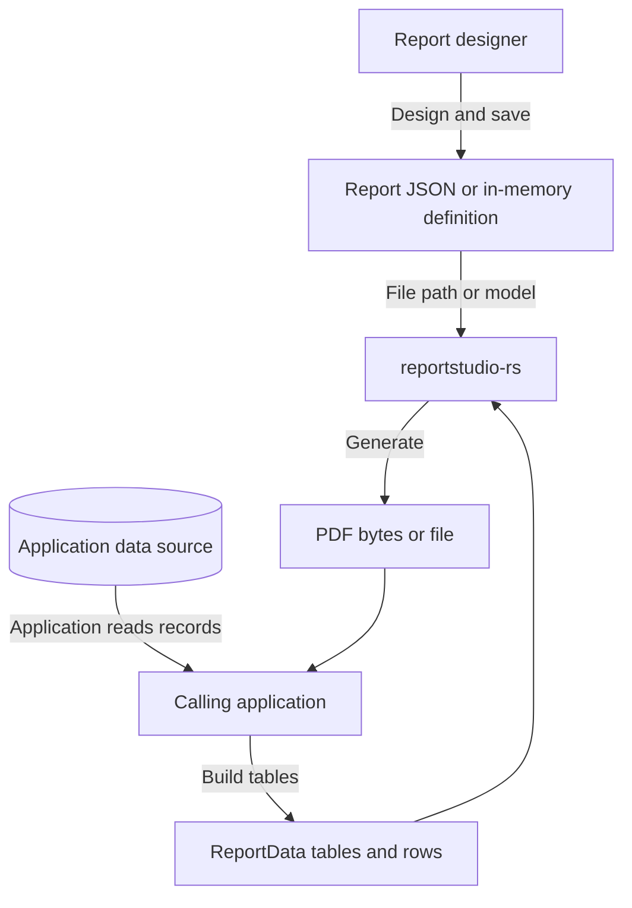
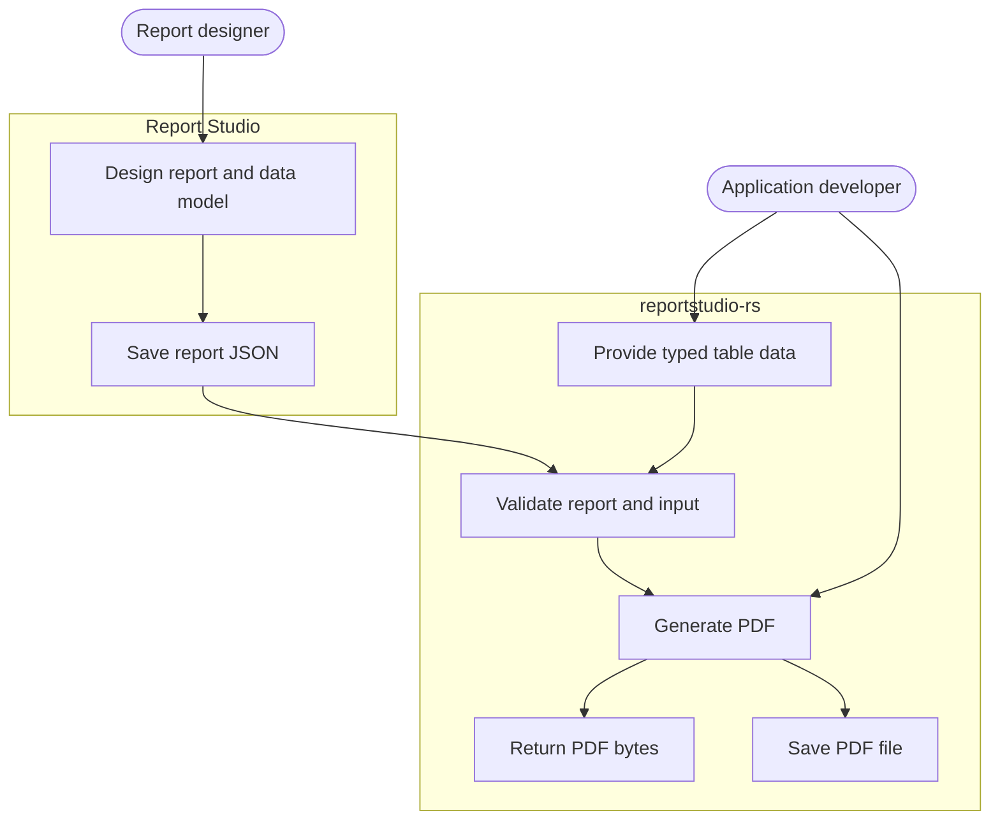
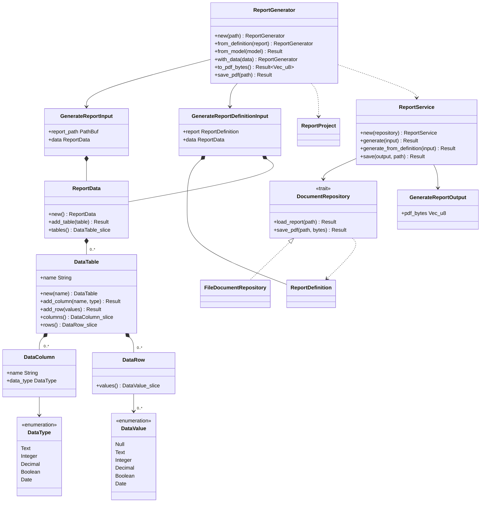
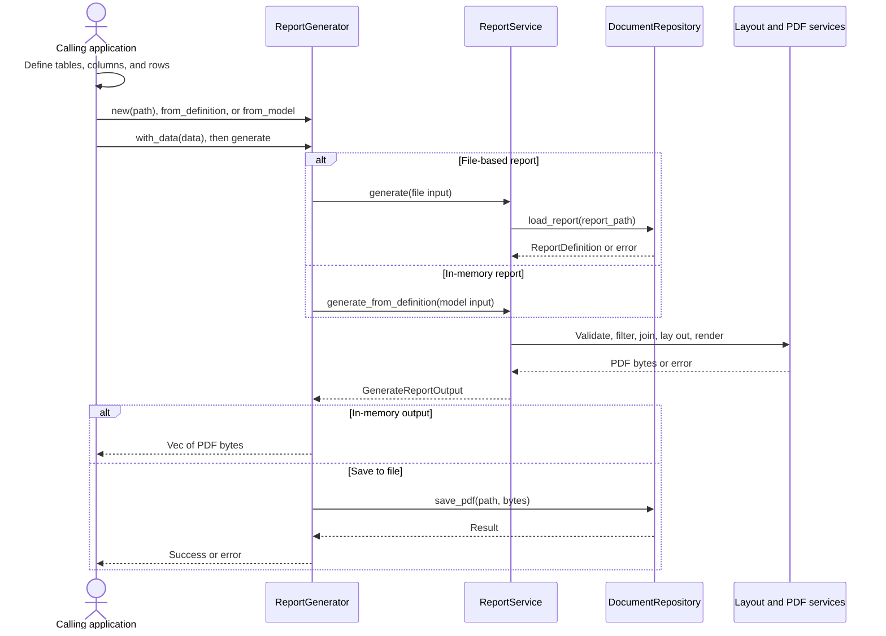

# reportstudio-rs

Generate PDF reports in Rust from a **Report Studio report JSON** and tables supplied by your application. Design the layout in Report Studio, save the JSON, load the records from your own sources, and pass those records to this library. The library reads the definition, validates the input, resolves fields and supported relationships, lays out the pages, and returns PDF bytes or writes a PDF file.

The renderer is under active development. It supports the features described below and returns an error for many unsupported features; it is not yet a complete implementation of every Report Studio report. See [supported features and limitations](#supported-features-and-limitations) before adopting a template.

- **Input:** a report JSON file path, an in-memory `ReportDefinition`, or an editable `ReportProject` model, and an in-memory `ReportData` collection.
- **Output:** an in-memory `Vec<u8>` or a PDF file at a path you choose.
- **Platforms:** Rust applications on macOS, Windows, and Linux; no desktop application is required at runtime.
- **Data sources:** your code supplies the records. This library does not connect to a database, execute SQL, or retrieve data from an API.
- **License:** the crate is declared MIT; bundled fonts have separate licenses. See [fonts and third-party licenses](#fonts-and-third-party-licenses).

## Contents

- [How it is used](#how-it-is-used)
- [Installation](#installation)
- [Quick start](#quick-start)
- [In-memory report definitions](#in-memory-report-definitions)
- [Data model and values](#data-model-and-values)
- [Report JSON](#report-json)
- [Relationships](#relationships)
- [Parameters](#parameters)
- [Expressions and formatting](#expressions-and-formatting)
- [Errors and file handling](#errors-and-file-handling)
- [API and architecture](#api-and-architecture)
- [Generation process](#generation-process)
- [Supported features and limitations](#supported-features-and-limitations)
- [Examples and tests](#examples-and-tests)
- [CI and releases](#ci-and-releases)

## How it is used

The diagram describes responsibilities around the library. The caller can be a desktop application, a web service, a command-line tool, or another Rust program.



Typical use cases are shown below. Rectangles represent use cases; the two external participants are the report designer and the application developer.



## Installation

Add the crate to `Cargo.toml` **after the desired version is published to crates.io**:

```toml
[dependencies]
reportstudio = "0.1"
```

For local development before publication, point to your checkout instead:

```toml
[dependencies]
reportstudio = { path = "../reportstudio-rs" }
```

For file-based input, the application must have access to a supported report JSON file. Saving to disk requires permission to write to the destination. The library embeds its fallback font; it does not require an installed system font for that fallback.

## Quick start

From a checkout of this repository, generate the included example:

```sh
cargo run --example generate
```

The command reads [`examples/simple-report.json`](examples/simple-report.json), supplies two detail records, and writes `example.pdf` in the current directory. The report defines the dataset ID `details` and the field `description`.

The following complete program uses that same report. Run it with the checkout as the working directory, or replace the JSON path with the path to your own report:

```rust
use reportstudio::{DataTable, DataType, ReportData, ReportGenerator};

fn main() -> reportstudio::Result<()> {
    let mut details = DataTable::new("details");
    details.add_column("description", DataType::Text)?;
    details.add_row(vec!["Implementation consulting".into()])?;
    details.add_row(vec!["Report development".into()])?;

    let mut data = ReportData::new();
    data.add_table(details)?;

    let generator = ReportGenerator::new("examples/simple-report.json")
        .with_data(data);

    generator.save_pdf("report.pdf")?;
    println!("Created report.pdf");
    Ok(())
}
```

To send the PDF as an HTTP response, attach it to a message, or store it elsewhere, use the `generator` from the previous example and request the bytes instead:

```rust
let pdf: Vec<u8> = generator.to_pdf_bytes()?;
// Pass `pdf` to your application's response or storage layer.
```

`ReportGenerator::new` takes a report **path**, not JSON bytes. Use `ReportGenerator::from_definition` or `ReportGenerator::from_model` for a report already in memory. `with_data` takes ownership of `ReportData` and returns the generator; calling it again replaces its data. Each call to `to_pdf_bytes` or `save_pdf` renders the report again. The file-based generator reloads the file each time; the in-memory generator uses its owned definition. A generator constructed without `with_data` starts with empty data and fails if its report needs tables.

## In-memory report definitions

Use `ReportProject` and `ReportGenerator::from_model` for an editable typed model, or `ReportDefinition` and `ReportGenerator::from_definition` to pass the complete JSON value directly. Neither path reads a report file at runtime. The same schema and feature validation used for file-based reports runs during generation.

```rust
use reportstudio::{DataTable, DataType, ReportData, ReportGenerator, ReportProject};

fn main() -> reportstudio::Result<()> {
    // The JSON is embedded at compile time; the resulting model is editable.
    let mut project: ReportProject = serde_json::from_str(include_str!("simple-report.json"))?;
    if let Some(header) = project.report.header.as_mut() {
        header.elements[0].text = Some("Report created from a model".into());
    }

    let mut details = DataTable::new("details");
    details.add_column("description", DataType::Text)?;
    details.add_row(vec!["Implementation consulting".into()])?;
    let mut data = ReportData::new();
    data.add_table(details)?;

    let pdf = ReportGenerator::from_model(&project)?
        .with_data(data)
        .to_pdf_bytes()?;
    std::fs::write("in-memory.pdf", pdf)?;
    Ok(())
}
```

For a runnable version of this example, run `cargo run --example in_memory` from the project root. `include_str!` in that example resolves relative to [`examples/in_memory.rs`](examples/in_memory.rs) at **compile time**; it is not a runtime file read. When copying the snippet, adjust the `include_str!` path relative to your own Rust source file or pass your own JSON string.

`ReportProject` exposes the main project, report, page, margin, dataset, field, band, element, detail, formula, relation, and parameter structures. These types are available under `reportstudio::models::report_schema`. Their `extra` maps preserve additional properties; advanced element settings such as chart, table and style are retained as JSON values. Serialization may normalize omitted and null optional properties. The type model does not imply that every represented feature is supported by the renderer. For Serde use, add `serde_json = "1"` to the calling application.

Other ways to construct a definition are:

- `ReportDefinition::from_json_value(value)` for a `serde_json::Value` already in memory.
- `ReportDefinition::from_json_str(text)` for JSON text; malformed JSON returns `Error::Json`.
- `ReportDefinition::from_serializable(&model)` for an application-defined Rust model implementing `serde::Serialize`. The serialized value must follow the Report Studio JSON structure. The application needs its own direct `serde` dependency and any types it uses for the model.
- `serde_json::from_str::<ReportDefinition>(text)` or `serde_json::to_string(&definition)` for Serde-based deserialization or serialization.

These constructors parse or convert the document; they do not guarantee that its contents form a valid or supported report. Generation reports malformed schemas, invalid data, and unsupported features through the same error types as the file-based path. `ReportDefinition::as_json_value()` provides read-only access to the retained JSON value.

For lower-level service integrations, [`GenerateReportDefinitionInput`](src/models/input.rs) contains the definition and data; pass it to `ReportService::generate_from_definition`. `GenerateReportInput` and `ReportService::generate` continue to accept file-based input.

## Data model and values

`ReportData` holds named `DataTable` values. A table has a name, ordered columns, and ordered rows. The table name must match the report dataset **ID**; it is not necessarily the display name shown in the designer. Field names must match the report schema and expressions.

```rust
use reportstudio::{DataTable, DataType, DataValue, ReportData};

fn make_data() -> reportstudio::Result<ReportData> {
    let mut shipments = DataTable::new("shipments");
    shipments.add_column("id", DataType::Integer)?;
    shipments.add_column("description", DataType::Text)?;
    shipments.add_column("weight", DataType::Decimal)?;
    shipments.add_column("confirmed", DataType::Boolean)?;
    shipments.add_column("departureDate", DataType::Date)?;
    shipments.add_row(vec![
        1001_i64.into(),
        "Medical supplies".into(),
        125.5_f64.into(),
        true.into(),
        DataValue::Date("2026-10-15".into()),
    ])?;
    shipments.add_row(vec![
        1002_i64.into(),
        "Spare parts".into(),
        42.0_f64.into(),
        false.into(),
        DataValue::Null,
    ])?;

    let mut data = ReportData::new();
    data.add_table(shipments)?;
    Ok(data)
}
```

| `DataType` | Accepted non-null `DataValue` | Example |
| --- | --- | --- |
| `Text` | `Text(String)` | `"Cargo".into()` |
| `Integer` | `Integer(i64)` | `42_i64.into()` |
| `Decimal` | `Decimal(f64)` or `Integer(i64)` | `42.5_f64.into()` |
| `Boolean` | `Boolean(bool)` | `true.into()` |
| `Date` | `Date(String)` | `DataValue::Date("2026-10-15".into())` |

`DataValue::Null` is accepted by every column type. Dates must use a valid Gregorian `YYYY-MM-DD` date. Decimal values must be finite: `NaN` and infinity are rejected. `&str`, `String`, `i32`, `i64`, `f64`, and `bool` implement conversion to `DataValue`; a date must be constructed explicitly.

**Order matters:** add all columns before adding the first row. Each row must contain exactly one value per column in declaration order. Empty or duplicate column names and duplicate or empty table names are rejected. Extra tables or columns can be supplied, but all declared fields in each supplied dataset must exist with compatible types. The schema's `number` type accepts integer and decimal columns; its `text` type accepts text and date columns.

You can inspect tables through `ReportData::tables()`, `DataTable::columns()`, `DataTable::rows()`, and `DataRow::values()`. Filtering and layout use a copy of the input data; they do not alter the caller's original records.

## Report JSON

Create and save a report in Report Studio, then supply its path to `ReportGenerator`. The library currently accepts `version: 1` and, when present, `schemaVersion: 1`. The full JSON format can contain features the Rust renderer does not yet support; a report that loads in the designer may still return `Error::Unsupported` here.

This is the structure of the included minimal report, simplified to one detail field:

```json
{
  "version": 1,
  "schemaVersion": 1,
  "datasets": [
    {
      "id": "details",
      "name": "Details",
      "schema": { "fields": [{ "name": "description", "type": "text" }] },
      "data": []
    }
  ],
  "report": {
    "version": 1,
    "id": "simple-example",
    "title": "Simple example",
    "locale": "en-US",
    "currency": "USD",
    "page": {
      "width": 8.5,
      "height": 11,
      "margins": { "top": 0.5, "right": 0.5, "bottom": 0.5, "left": 0.5 }
    },
    "header": {
      "id": "header",
      "height": 0.5,
      "elements": [{
        "id": "title", "type": "text", "x": 0, "y": 0,
        "width": 4, "height": 0.3, "text": "Simple report",
        "style": { "fontsize": 16, "bold": true, "color": "#17213a" }
      }]
    },
    "details": [{
      "id": "detail",
      "dataset": "details",
      "band": {
        "id": "detail-band", "height": 0.3,
        "elements": [{
          "id": "description", "type": "text", "x": 0, "y": 0,
          "width": 4, "height": 0.2, "text": "[description]",
          "style": { "fontsize": 10, "color": "#17213a" }
        }]
      }
    }]
  }
}
```

Page size, margins, section heights, and element positions and dimensions are expressed in **inches**; font sizes are in points. A detail band bound to `details` is rendered for its supplied records. The example's `data: []` describes the template; the Rust library uses the separately supplied `ReportData` instead of loading embedded sample records.

For a larger reference, see [`examples/awb/awb-full-form-example.json`](examples/awb/awb-full-form-example.json). Its data is fictional. The accompanying [`examples/awb_fixture.rs`](examples/awb_fixture.rs) converts its sample tables into `ReportData` and generates an air waybill; production applications should supply their own records.

## Relationships

Define relationships in the report JSON and provide all participating tables with their named columns. The following is a **fragment**, not a complete report:

```json
{
  "relations": [{
    "id": "customer-orders",
    "from": { "dataset": "customers", "field": "id" },
    "to": { "dataset": "orders", "field": "customerId" },
    "cardinality": "1:n"
  }]
}
```

For example, provide `customers.id`, `customers.name`, and `orders.customerId`, and use `[customers.name]` in an order detail band. Unqualified fields such as `[customerId]` use the current detail dataset. Equality joins require compatible column types; null keys do not match. Linked rows with no matching key are not rendered as matched detail combinations. Validate the relationship and required columns in the report and in the supplied data.

## Parameters

The renderer applies values already present in the report JSON before rendering. This fragment selects rows whose `description` contains `consulting`, ignoring case:

```json
{
  "parameters": [{
    "id": "descriptionFilter",
    "label": "Description",
    "type": "text",
    "dataset": "details",
    "field": "description",
    "operator": "contains",
    "value": "consulting",
    "saveValue": true
  }]
}
```

Supported operators are `eq`, `contains`, `gte`, and `lte`. Active parameters are combined as filters. `value` takes precedence over `defaultValue` when it is present and non-null; an empty value does not apply a filter. A required parameter with no value produces an error. Null values do not satisfy range comparisons.

There is **no public parameter override API or interactive prompt** in the Rust library yet. To change a value, prepare a report definition containing that value before invoking the renderer. Do not put secrets into a persisted JSON file merely to pass them to the library. `saveValue` is a designer persistence setting; the Rust generator does not itself prompt for missing values.

## Expressions and formatting

Text can contain fields and supported expressions in brackets. Named formulas are declared in `report.formulas`; for example, a detail dataset containing numeric `quantity` and `price` fields can use:

```json
{
  "formulas": [{ "name": "LineTotal", "expression": "quantity * price" }]
}
```

A detail element can display `[LineTotal]`, and a detail group footer can use `[SUM(LineTotal)]`. Supported expressions include arithmetic, comparisons, boolean operators, named formulas, `IF(condition, then, else)`, and `SUM(expression)`. Supported special fields include `ROW_NUMBER`, `PAGE_NUMBER`, and `PAGE_COUNT`. Circular formulas and unsupported functions are reported as errors. Section visibility may use a boolean expression; a section background expression must return a `#RRGGBB` string.

Text `style.format` supports `text`, `number`, `currency`, `percent`, and `date`. Numeric and date formatting currently supports the report locales `en-US` and `es-MX`; supported currency codes are `USD`, `MXN`, `EUR`, `CAD`, `GBP`, and `JPY`. Unsupported locale or currency combinations return an error when formatting requires them. See [`tests/format_contract.rs`](tests/format_contract.rs) and [`tests/expression_contract.rs`](tests/expression_contract.rs) for executable examples.

## Errors and file handling

Public methods return `reportstudio::Result<T>`, whose error is `reportstudio::Error`:

| Variant | Meaning |
| --- | --- |
| `Io` | The report cannot be read or the destination cannot be written. |
| `Json` | The report is not valid JSON. |
| `InvalidData` | Supplied tables, columns, rows, or values do not meet the input contract. |
| `InvalidReport` | A report definition or expression is invalid. |
| `Unsupported` | The report requests a feature the renderer does not support. |

Handle errors at the application boundary instead of treating an unsupported report as a successful PDF:

For example, given an existing `ReportData` value named `data`:

```rust
match ReportGenerator::new("reports/invoice.json").with_data(data).to_pdf_bytes() {
    Ok(bytes) => println!("Generated {} PDF bytes", bytes.len()),
    Err(error) => eprintln!("Could not generate report: {error}"),
}
```

`save_pdf` renders before it writes, so validation or rendering errors do not write the destination. On successful rendering, the filesystem repository uses a normal file write: an existing destination can be overwritten, parent directories are not created automatically, and a filesystem write failure is not guaranteed to be atomic. Choose paths and handle overwrite policy in your application.

## API and architecture

The public facade re-exports the common types from `reportstudio`. Advanced integrations can use `services::ReportService`, `repository::DocumentRepository`, and the input and output models. The actual dependency direction is **application → services → repository → models**; each layer accesses only its immediate lower layer.



The default `ReportGenerator` uses `ReportService<FileDocumentRepository>`. For a custom storage implementation, implement `DocumentRepository`, construct `ReportService::new(repository)`, and call `generate` with `models::input::GenerateReportInput`; `generate` returns `models::output::GenerateReportOutput`. `ReportDefinition::from_json_value` lets a custom repository supply a parsed `serde_json::Value`. A custom repository is the lower-level extension point for controlling report loading and PDF persistence. Use `ReportGenerator::from_definition` or `from_model` when only in-memory report input is needed.

### Custom repository example

The following complete example supplies the report definition from an in-memory JSON value and saves output through the repository's `save_pdf` implementation. Add `serde_json = "1"` as a direct dependency of the calling application. This example reads the included JSON once for demonstration; the value could instead come from your own storage. Run it from the project root or change the source path.

```rust
use std::{fs, path::{Path, PathBuf}};
use reportstudio::{DataTable, DataType, ReportData, Result};
use reportstudio::models::{input::GenerateReportInput, ReportDefinition};
use reportstudio::repository::DocumentRepository;
use reportstudio::services::ReportService;

struct MemoryReportRepository {
    definition: serde_json::Value,
}

impl DocumentRepository for MemoryReportRepository {
    fn load_report(&self, _path: &Path) -> Result<ReportDefinition> {
        Ok(ReportDefinition::from_json_value(self.definition.clone()))
    }

    fn save_pdf(&self, path: &Path, bytes: &[u8]) -> Result<()> {
        fs::write(path, bytes)?;
        Ok(())
    }
}

fn main() -> Result<()> {
    let definition = serde_json::from_slice(&fs::read("examples/simple-report.json")?)?;
    let repository = MemoryReportRepository { definition };
    let service = ReportService::new(repository);

    let mut details = DataTable::new("details");
    details.add_column("description", DataType::Text)?;
    details.add_row(vec!["Consulting".into()])?;
    let mut data = ReportData::new();
    data.add_table(details)?;

    // This repository ignores the path, but the input model still requires one.
    let input = GenerateReportInput { report_path: PathBuf::from("memory.json"), data };
    let output = service.generate(&input)?;
    service.save(&output, Path::new("custom-report.pdf"))?;
    Ok(())
}
```

This extension point replaces report loading and PDF persistence; it does not change the renderer's supported features. An application can also use `output.pdf_bytes` directly without calling `save`.

## Generation process



In more detail, the service loads and parses a file-based definition or accepts an in-memory definition, applies saved parameter values to a copy of the supplied data, validates schemas and relationships, resolves fields and expressions, builds page content, and serializes PDF objects. A report that does not fit on one page is paginated when its bands and features are supported. A band must fit intact on a page. Page headers and footers can repeat; the report footer is placed on the final page. The process returns a typed error when it cannot safely render a requested feature.

## Supported features and limitations

| Area | Current support and important limits |
| --- | --- |
| Text | Helvetica variants, alignment, multiline text, wrapping, underline, WinAnsi, and a regular-weight Noto Sans JP fallback for supported BMP characters. Characters not covered by the embedded font, non-BMP characters, and bold or italic text needing the fallback are rejected. Complex script shaping is not complete. |
| Geometry | Lines and filled boxes. Supported report elements and sections must fit their page and section constraints. |
| Images | Embedded, opaque PNG data URLs. Transparent PNGs, animated PNGs, other formats, and external image URLs are not supported. |
| Tables | Designer-expanded table cells and repeated detail bands. Raw unexpanded table definitions and dynamic table backgrounds are not supported. |
| Data and relations | Caller-supplied typed tables and equality relationships. Null keys do not match. The library does not fetch data or run SQL. |
| Parameters | Saved values and defaults with `eq`, `contains`, `gte`, and `lte`; no runtime override API or prompting. |
| Formulas | Arithmetic, comparisons, boolean operators, named formulas, `IF`, and `SUM`. Other functions and full expression-language parity are pending. |
| Sections and groups | Page and report headers/footers, visibility and background expressions, detail row numbers, and a single `groupBy` field with group-scoped sums. Text group ordering is ASCII-only; nested `groups`, nested footer bands, and backgrounds on nested bands are unsupported. |
| Charts | Data-bound bar and column charts, with aggregation, sorting, category colors, labels, and grids. Line, area, pie, and donut charts are not supported. Appearance is not yet pixel-identical to the designer. |
| Output | PDF bytes or file. There is no standalone preview UI in this crate. |

Unsupported behavior is deliberately surfaced as an error in many cases. Passing the included tests does not establish complete visual or behavioral equivalence for every report. Verify your own templates and data, especially around pagination and layout.

## Examples and tests

- [`examples/simple-report.json`](examples/simple-report.json) and [`examples/generate.rs`](examples/generate.rs): a minimal report and typed detail records.
- [`examples/in_memory.rs`](examples/in_memory.rs): generate from an in-memory definition without reading the report file at runtime.
- [`examples/awb/`](examples/awb/): a fictional air waybill, its designer reference PDF, and notes about compatibility.
- [`tests/`](tests/): data, relationships, formatting, chart, grouping, pagination, image, expression, and error contracts.
- [`tests/features/implemented/`](tests/features/implemented/): executable Cucumber scenarios. [`tests/features/pending/`](tests/features/pending/) contains specifications that are not executed.

Run the Rust suite, including Cucumber:

```sh
cargo test --locked --all-targets
cargo test --locked --test bdd
cargo fmt --all -- --check
cargo clippy --locked --all-targets -- -D warnings
```

The optional browser suite generates real PDFs, opens them with PDF.js in Chromium, and checks text, page geometry and pixels, including comparisons with designer fixtures. It uses Node.js 22 or later and a temporary loopback server:

```sh
cd tests/browser
npm ci
npx playwright install chromium
npm test
```

`npm run test:all` runs the Rust suite and then the browser suite. Browser tests do not run as part of `cargo test`. The AWB visual comparison covers the included one-page fictional example with a tolerance for raster differences; it is not a general guarantee of pixel equivalence.

## Fonts and third-party licenses

The library uses Helvetica-compatible standard-font metrics; see [`LICENSE.standard-fonts`](LICENSE.standard-fonts). It embeds a regular-weight static instance of Noto Sans JP as a Unicode fallback under the SIL Open Font License; see [`assets/fonts/OFL-NotoSansJP.txt`](assets/fonts/OFL-NotoSansJP.txt). PDFs that need this fallback include the font and a Unicode text mapping and are approximately 5.5 MiB larger. The static instance was generated from the Google Fonts Noto Sans JP variable font at weight 400 using FontTools.

## CI and releases

GitHub Actions runs formatting and Clippy checks on Linux, Rust unit, integration and Cucumber tests on Linux, macOS and Windows, and PDF.js/Playwright browser checks on Linux for pushes and pull requests. The same checks run before a release is packaged.

To publish a release:

1. Configure the repository secret `CARGO_REGISTRY_TOKEN` with a crates.io API token authorized to publish `reportstudio`. For a first publication, the token must be allowed to publish a new crate. The `crates-io` GitHub environment may optionally be protected with required reviewers; its environment secrets can also hold the token.
2. Update the version in `Cargo.toml` and `Cargo.lock`, commit all required source files, fonts, licenses, examples, JSON fixtures and designer reference PDFs, and push the commit. The version must be available on crates.io.
3. Create a Git tag matching the manifest version, such as `v0.1.0`, push it, and publish a GitHub Release for that tag. The workflow also accepts a tag without the `v` prefix. Publishing a draft release starts the workflow; saving a draft does not.
4. After all checks pass, Actions verifies the package, publishes it to crates.io, and attaches the `.crate` and its SHA-256 checksum to the GitHub Release. Existing release assets are left untouched if their bytes differ. A `.crate` contains source and assets for Cargo to compile; it is not a standalone executable.

The release workflow does not modify the version from the tag. This keeps the published package tied to the committed manifest and lockfile. To inspect a package locally, run `cargo package --locked --list` and `cargo publish --locked --dry-run`. The latter does not publish. Release and registry publication are separate jobs: inspect both job results if either fails. A rerun skips an already published crate only when its bytes match the validated package. Once a version is published, crates.io does not permit replacing its contents; publish a new version for changes.
